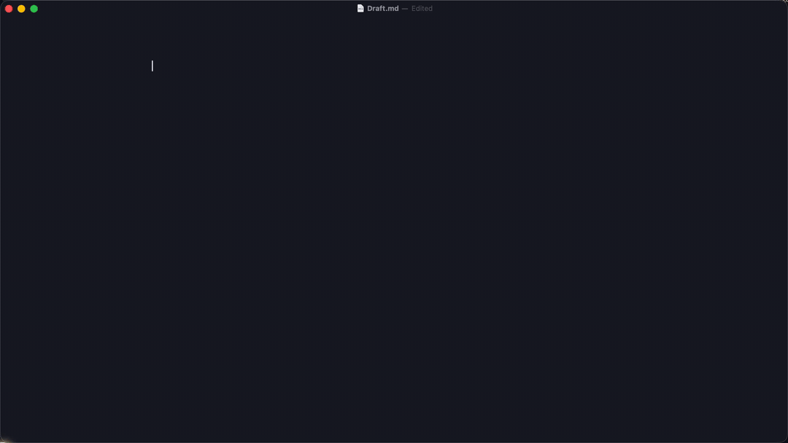

# GhostType

System-wide inline AI autocomplete for macOS, fully on-device. Stop typing for
a moment in Notes, Mail, Word, Outlook, Typora, the Claude desktop app or an
AI-chat browser tab, and a gray suggestion appears right after your caret.
**Tab** takes one word, **§** takes all of it. No text leaves the machine.



## Keys

| Key | Action |
|---|---|
| **Tab** | Accept the next word |
| **§** | Accept the whole suggestion |
| Esc / any other key / click | Dismiss |
| ⌘⌥G | Turn GhostType on/off |
| ⌘⌥S | Proofread the current sentence (optional spellcheck service) |
| ⌘⌥P | Probe whether the focused field supports GhostType |

Tab and § are only intercepted while a suggestion is on screen, so normal Tab
behavior is untouched everywhere else.

## How it works

1. **Read the caret.** A Hammerspoon eventtap waits for a pause in typing,
   then reads the focused field through the macOS Accessibility API: the text
   around the caret (`AXValue` sliced at `AXSelectedTextRange`) and the caret's
   screen rect (`AXBoundsForRange`).
2. **Chromium and WebKit fallbacks.** In Chromium apps (Claude, Chrome, Arc)
   and WebKit compose windows `AXBoundsForRange` returns placeholders, so
   GhostType walks AX *text markers* (`AXTextMarkerRange…`) to get the exact
   caret rect. Where nothing usable exists it estimates from font metrics, and
   `⌘⌥P` reports which path a field takes (`full` / `markers` / `estimated` /
   `no-go`).
3. **Complete locally.** Prefix and suffix go to a small FastAPI server
   (`server/ghosttype_server.py`) that runs a 1B fill-in-the-middle base model
   (`mlx-community/granite-4.0-1b-base-4bit`) on Apple Silicon with
   [mlx-lm](https://github.com/ml-explore/mlx-lm). Generation streams and stops
   at the word cap or a newline, so a suggestion costs a couple of hundred ms.
4. **Draw.** The suggestion is rendered in a click-through `hs.canvas` overlay
   at the caret. Accepting types it with synthetic keystrokes; if you keep
   typing the predicted characters, the ghost text is trimmed locally instead
   of re-querying the model.

**Context matters more than the model.** With the same model, one client got
about **3× the acceptance rate** of the other, and the difference was the
context it sent: the document title and the enclosing headings. Every request
now carries both (`contextTitle`, and the Obsidian plugin adds headings that
scrolled out of the window). Titles that are just an app name or "Untitled"
are refused, because base models parrot whatever you prepend.

## Install

Requires an Apple Silicon Mac, Python 3.11+ and
[Hammerspoon](https://www.hammerspoon.org/) with Accessibility permission.

```bash
git clone https://github.com/miksterister/ghosttype.git
cd ghosttype
./server/start_server.sh        # first run: creates ~/.venvs/ghosttype, downloads the model (~600 MB)
```

Leave it running on `127.0.0.1:8790` (or Ctrl-C once the model is cached).
Then install the Hammerspoon module and the launchd services that GhostType
starts and stops on its own:

```bash
./scripts/install.sh            # symlinks ~/.hammerspoon/ghosttype, installs 2 LaunchAgents
echo 'require("ghosttype")' >> ~/.hammerspoon/init.lua
```

Reload Hammerspoon. A "GhostType ready" notification and a menu bar item
appear; settings are in the menu bar item and in
`~/.config/ghosttype/config.json`.

Manual server setup, if you prefer your own venv:

```bash
pip install -r server/requirements.txt
pip install "transformers<5"    # mlx-lm 0.31.3 declares >=5 but crashes on it
uvicorn --app-dir server ghosttype_server:app --host 127.0.0.1 --port 8790
```

### Optional pieces

- **Spellcheck (⌘⌥S)** — `server/start_spellcheck.sh` serves sentence-level
  corrections on `:8791`. Default backend is [Ollama](https://ollama.com)
  (`gemma4:e4b-mlx`); `GHOSTTYPE_SPELL_BACKEND=encoder` uses the 350M
  LFM2.5 tagger in-process instead.
- **Obsidian** — `obsidian-plugin/` is a CodeMirror 6 plugin that talks to the
  same server with pixel-exact ghost text. See its README.

## Configuration

Defaults live in `config.lua`; your overrides go to
`~/.config/ghosttype/config.json` (the Settings window writes it). Per-app
profiles enable or disable apps, and browsers are limited to AI-chat tabs by
URL/title patterns. Logs go to `~/Library/Logs/ghosttype/`.

## Tests

```bash
./tests/run.sh                                  # Lua unit tests (stubbed hs), no Hammerspoon needed
~/.venvs/ghosttype/bin/python server/test_fim_prompt.py
```

## License

MIT, see [LICENSE](LICENSE).
